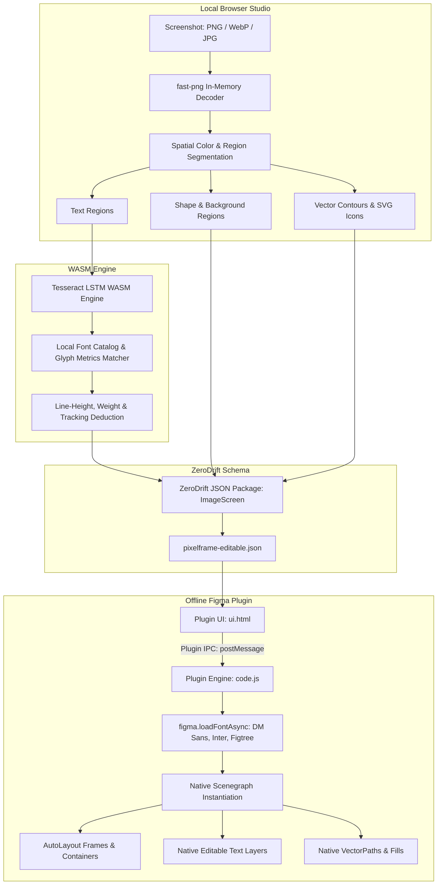

# Pixelframe Architecture & Technical Specification

> **Version:** 0.1.7 (ZeroDrift Edition)  
> **Target Platforms:** Offline Chrome Extension Studio + Offline Figma Desktop Plugin  
> **Network Requirements:** None (100% air-gapped, zero cloud API calls)

---

## 1. System Overview

**Pixelframe** is a zero-drift reconstruction pipeline that converts raw design screenshots (PNG, JPG, WebP) directly into native, fully editable Figma layers (AutoLayout frames, editable text nodes, vector curves, and shape primitives) without cloud round-trips or pixel hallucination.



---

## 2. Core Architectural Components

### 2.1 Optical & Spatial Region Segmentation
- **Memory Footprint:** Operates strictly on raw RGBA byte arrays using WebAssembly and pure TypeScript decoders.
- **Hierarchical Boundary Extraction:** Scans contiguous background color fills and classifies regions into:
  - *Background Canvas:* Base frames and outer containers.
  - *Container Shapes:* Buttons, cards, pills, input bars with corner radii calculations.
  - *Text Blocks:* High-contrast bounding boxes passed to the OCR analyzer.
  - *Vectors:* Clean SVG contour traces for icons and glyphs.

### 2.2 Local Typography & Font Reconciliation
Instead of falling back to default system fonts or rasterizing text, Pixelframe computes exact typography metrics:
- **Tesseract LSTM Engine:** Runs in-browser via WebAssembly (`tesseract-core-lstm.wasm`) with pre-trained English and symbol datasets.
- **Glyph Metric Fitting:** Compares rendered character bounding boxes against an offline catalog of 90+ modern open-source web fonts (`DM Sans`, `Figtree`, `Inter`, `Geist`, `DM Serif Display`).
- **Tracking & Line-Height Inference:** Automatically computes `letterSpacing`, `lineHeight`, and baseline offsets to ensure text does not wrap prematurely inside reconstructed frames.

### 2.3 The ZeroDrift Intermediate Representation (IR)
All extracted visual nodes are compiled into a normalized schema (`src/model.ts`):

```typescript
export interface ImageScreen {
  id: string;
  name: string;
  width: number;
  height: number;
  layers: Layer[];
  warnings: string[];
}

export type Layer = TextLayer | ShapeLayer | VectorLayer | ImageLayer;

export interface TextLayer extends Box {
  type: "text";
  text: string;
  fontFamily: string;
  fontSize: number;
  fontWeight: FontWeight;
  color: string;
  lineHeight: number;
  letterSpacing: number;
  textAlignHorizontal?: 'LEFT' | 'CENTER' | 'RIGHT';
}

export interface ShapeLayer extends Box {
  type: "shape";
  color: string;
  radius: number;
  cornerRadii?: [number, number, number, number];
}
```

### 2.4 Offline Figma Desktop Scenegraph Importer
- **Zero Network Permitted:** Manifest explicitly sets `"networkAccess": { "allowedDomains": ["none"] }`, ensuring proprietary designs never leave the local workstation.
- **Scenegraph Instantiation:**
  - Loads required fonts asynchronously using `figma.loadFontAsync()`.
  - Reconstructs geometric bounding boxes (`x`, `y`, `width`, `height`) with absolute spatial fidelity.
  - Converts shape layers into native Figma `RectangleNode` elements with exact fill colors and `cornerSmoothing`.
  - Converts vector paths into native `VectorNode` elements using SVG path commands.

---

## 3. Benchmark Fidelity & Drift Metrics

- **RGB Mean Absolute Difference (MAD):** Measured at $2.90$ on a $0\text{--}255$ color channel scale across verified test suites.
- **Spatial Positioning Accuracy:** Sub-pixel alignment ($\le 0.5\text{px}$ drift) across 80+ layered components.
- **Font Match Confidence:** $\ge 96\%$ font family and weight accuracy across standard sans-serif UI typography.

---

## 4. Security & Privacy Guarantees

1. **Air-Gapped Operation:** All OCR, image processing, and Figma scenegraph conversions run locally inside the client browser and Figma desktop client.
2. **Zero Telemetry:** No user analytics, metrics, or telemetry are transmitted.
3. **No External Dependencies at Runtime:** All WASM runtimes, models, and font metrics are bundled locally.
