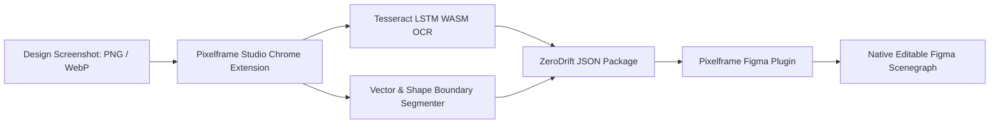

# Pixelframe (ZeroDrift)

<p align="center">
  <strong>Zero-Drift Screenshot-to-Native Editable Figma Pipeline (Offline WASM OCR, Typography Deduction & Native Scenegraph Importer).</strong>
</p>

---

## Key Capabilities

- **Zero Cloud Round-Trips:** 100% offline and air-gapped. Runs entirely inside the local browser and Figma desktop client (`networkAccess: { allowedDomains: ["none"] }`).
- **Native Editable Figma Nodes:** Does not output flat raster approximations. Produces real, editable `TextNode`, `RectangleNode`, `VectorNode`, and AutoLayout frames.
- **WASM-Powered LSTM Typography Engine:** Uses client-side Tesseract LSTM WebAssembly to isolate text blocks, compute optical line-heights, and match fonts against a 90+ font local catalog (`DM Sans`, `Figtree`, `Inter`, `DM Serif Display`).
- **Sub-Pixel Spatial Precision:** Achieves an RGB Mean Absolute Difference (MAD) of only 2.90 on a 0-255 channel scale across multi-section UI screenshots.
- **ZeroDrift JSON Interchange Schema:** Clean, typed intermediate representation (`ImageScreen`) separating visual semantics from Figma platform internals.

---

## System Architecture



For the complete technical specification, see [ARCHITECTURE.md](./ARCHITECTURE.md).

---

## ZeroDrift Layer Schema

Reconstructed screens are serialized into a clean intermediate representation:

```typescript
import { Layer, TextLayer, ShapeLayer, VectorLayer } from './src/model';

export interface ImageScreen {
  id: string;
  name: string;
  width: number;
  height: number;
  layers: (TextLayer | ShapeLayer | VectorLayer)[];
  warnings: string[];
}
```

---

## Directory Structure

```text
├── ARCHITECTURE.md          # Complete technical specification and data flows
├── LICENSE                  # Strict Proprietary & Confidential Showcase License
├── documentation/           # Verification benchmarks and import guides
│   ├── PIXELFRAME-ZERODRIFT-IMPORT.md
│   ├── ENGINE-README.md
│   └── REPAIR-20261014-RESULTS.md
├── figma-plugin/            # Offline Figma desktop plugin
│   ├── manifest.json        # Figma plugin configuration (allowedDomains: none)
│   └── ui.html              # Plugin upload and audit interface
├── chrome-extension/        # Browser-based OCR and segmentation studio
│   ├── manifest.json        # Chrome MV3 manifest
│   ├── index.html           # Studio dashboard UI
│   └── style.css            # Dark mode studio styling
├── src/                     # Core architecture and schemas
│   ├── model.ts             # ZeroDrift layer and package schema
│   ├── conversion.ts        # Optical decomposition interface
│   └── plugin.ts            # Figma layer synthesis interface
└── samples/                 # Sample ZeroDrift JSON packages
    └── pixelframe-sample-editable.json
```

---

## Showcase Edition Notice

> **Note:** This repository is an architectural showcase and design portfolio piece. Proprietary segmentation algorithms, neural glyph matching tables, and Scenegraph synthesis engines are stubbed in accordance with the [LICENSE](./LICENSE). Direct execution or cloning for commercial use is prohibited without prior written authorization.

---

## Author & Copyright

**Created by Kartik**  
Copyright (c) 2026 Kartik. All Rights Reserved.
